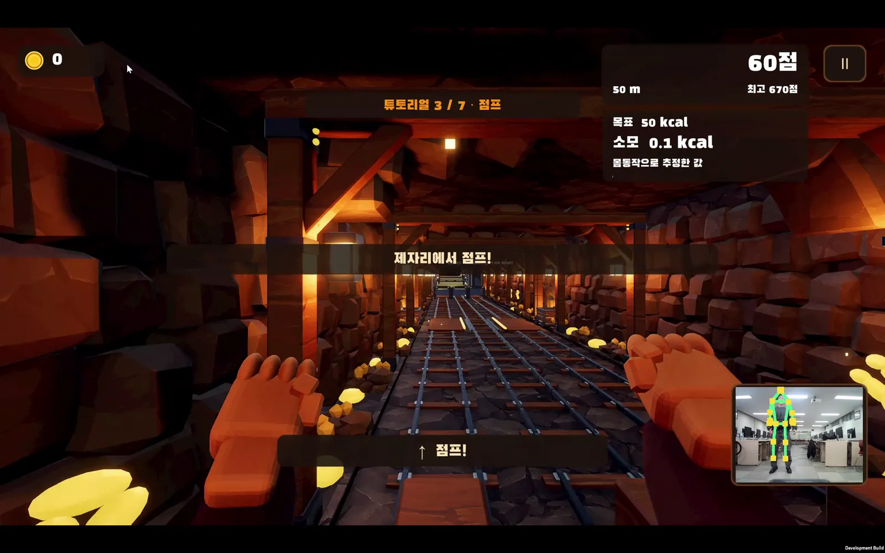
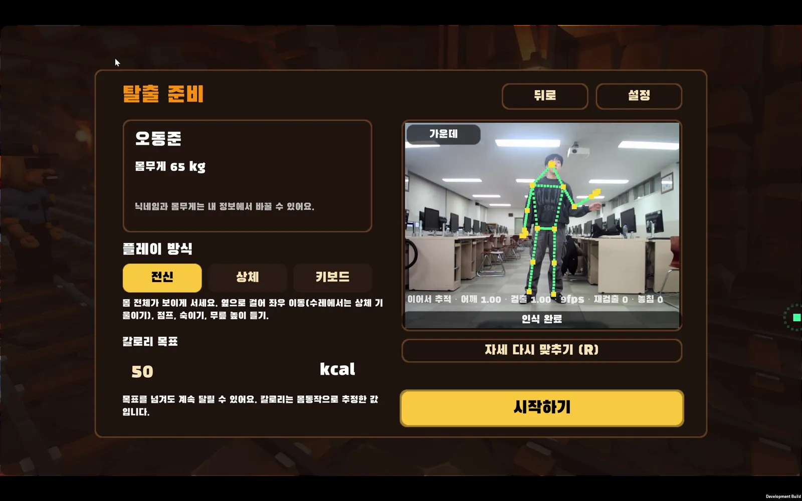
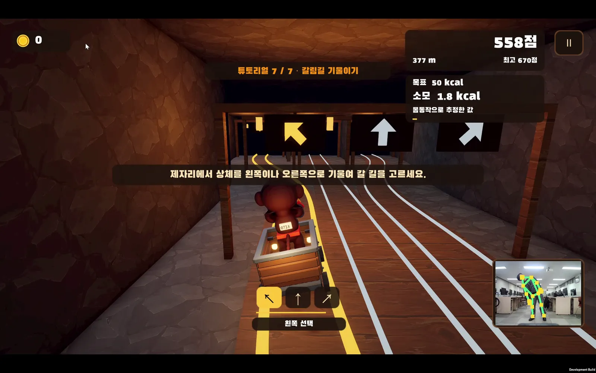
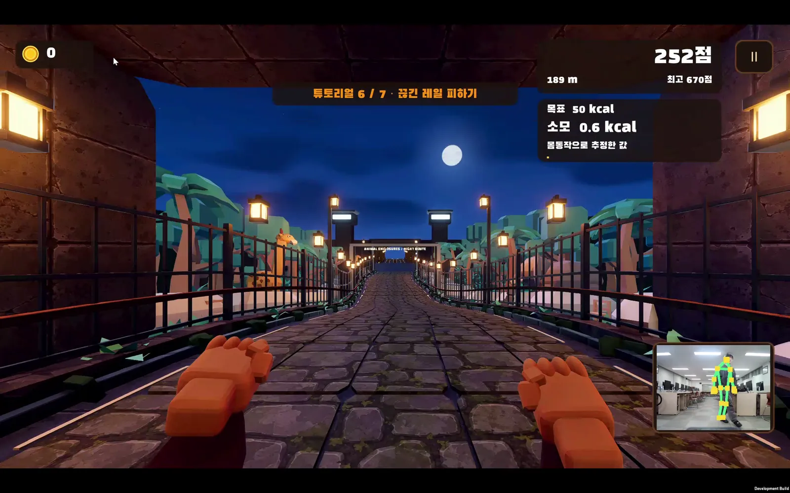
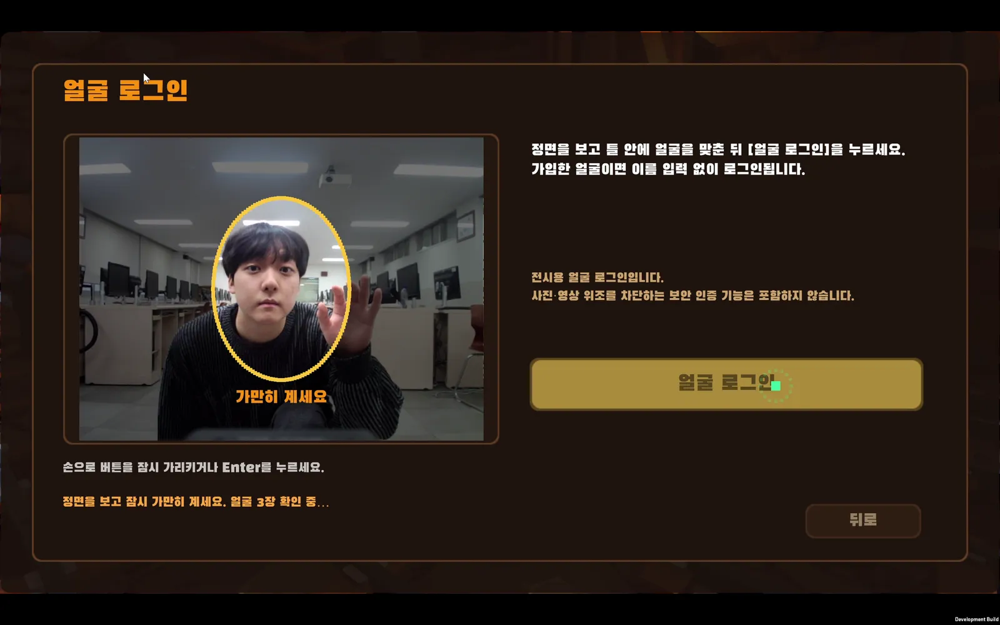
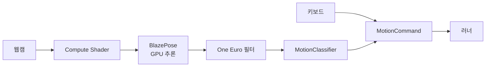

웹캠 앞에서 직접 뛰고, 숙이고, 무릎을 들어 광산과 감옥, 동물원을 빠져나가는 러너 게임

**[v1.0.0 내려받기](https://github.com/kihwan04/Mongscape/releases/tag/v1.0.0)** &nbsp;&nbsp; Windows 64비트

 

뒤에서 경찰이 쫓아오고, 레일 세 줄 위로 장애물이 날아옵니다. 바리케이드는 실제로 점프해서 넘고, 철창은 몸을 숙여 지나가고, 계단은 무릎을 번갈아 들어 오릅니다. 수레를 탄 구간에서는 몸을 기울여 갈림길을 고릅니다.

웹캠이 없으면 키보드로도 할 수 있습니다. 서 있기 어려운 곳에서는 앉아서 상체만 쓰는 방식을 고르면 됩니다.

점수는 달린 거리에 운동 칼로리를 더해 매깁니다. 키보드로 하면 칼로리는 0입니다.

## 시작하기

[릴리스](https://github.com/kihwan04/Mongscape/releases/tag/v1.0.0)에서 ZIP을 받아 풀고 `Mongscape.exe`를 실행합니다. 소스로 받았다면 맨 위의 `StartGame.cmd`를 실행합니다. 빌드가 있으면 그걸 띄우고, 없으면 Unity에서 소스를 엽니다.

타이틀에서 얼굴 로그인, 회원가입, 게스트 중 하나를 고릅니다. 회원은 코인을 모아 상점에서 아이템을 열고, 여러 PC의 기록이 한 랭킹에 모입니다. 게스트는 가입 없이 바로 할 수 있고 기록은 그 PC에만 남습니다.

| 키 | 동작 |
| --- | --- |
| A, D | 레인 이동 |
| C | 갈림길 가운데 |
| Space | 점프 |
| S | 숙이기 |
| W | 무릎 들기, 계단에서 연타 |
| F1 | 설정 |
| F3 | 성능 표시 |

<table>
  <tr>
    <td></td>
    <td></td>
  </tr>
  <tr>
    <td align="center">시작 전 자세 확인</td>
    <td align="center">수레 갈림길에서는 몸을 기울여 길을 고른다</td>
  </tr>
  <tr>
    <td></td>
    <td></td>
  </tr>
  <tr>
    <td align="center">동물원 구간 튜토리얼</td>
    <td align="center">얼굴 로그인</td>
  </tr>
</table>

## 몸동작을 읽는 방법

자세 인식은 게임을 돌리는 PC 안에서 끝납니다. 웹캠 영상을 Compute Shader로 정사각형 입력으로 바꾸고, BlazePose 모델을 Unity AI Inference로 GPU에서 돌립니다. 사람을 처음 찾을 때만 검출 모델을 쓰고, 그 뒤로는 직전 프레임의 관절 위치로 다음 영역을 잡아 이어서 추적합니다.

관절 좌표를 동작으로 바꾸는 건 `MotionClassifier`입니다. Unity에 기대지 않는 코드라 카메라 없이 테스트할 수 있습니다.

처음엔 몸이 조금만 흔들려도 레인이 바뀌었습니다. 그래서 구간마다 보는 곳을 나눴습니다. 달릴 때는 엉덩이가 어디 서 있는지만 보고, 수레에서는 어깨선이 얼마나 기울었는지만 봅니다. 숙이는 동안에는 좌우 이동과 점프를 막고, 점프하려고 무릎을 굽힌 걸 숙이기로 읽지 않게 했습니다.

키보드 입력과 몸동작은 똑같이 `MotionCommand`가 됩니다. 게임 쪽 코드는 입력이 어디서 왔는지 모릅니다.

## 얼굴 로그인 서버

`PrisonRunner/Services/Identity`에 있는 Python 서버가 얼굴 로그인과 계정을 맡습니다. OpenCV의 YuNet으로 얼굴을 찾고 SFace로 얼굴마다 다른 숫자 값을 뽑습니다. 얼굴 사진은 저장하지 않고 이 값만 PostgreSQL 17에 넣습니다.

서버는 Docker Compose로 Caddy, API, PostgreSQL을 묶어 VPS에 올렸습니다. 한 사람이 요청을 너무 자주 보내면 잠시 막고, 압축을 풀면 크기가 터무니없이 커지는 이미지는 받지 않습니다. DB는 매일 백업하고 14일치를 남깁니다.

서버가 없어도 게임은 됩니다. 얼굴 로그인만 안 될 뿐 게스트로 키보드와 몸동작 플레이를 모두 할 수 있습니다. 서버 주소를 정하는 방법은 [처음 실행하기](PrisonRunner/START_HERE.md)에, 서버를 띄우는 방법은 [서버 안내](PrisonRunner/Services/Identity/README_DOCKER.md)에 있습니다.

회원가입 때는 만 14세 이상 확인, 개인정보 수집, 얼굴 특징값 수집 동의를 따로따로 받습니다. 동의하지 않아도 게스트로 할 수 있습니다.

## 개발

Unity 6000.3.10f1로 `PrisonRunner/Unity`를 열고 메뉴의 **Mongscape → Play GameScene**을 누릅니다. Windows 실행 파일은 **Mongscape → Build Windows Demo**로 만듭니다.

테스트는 Unity EditMode와 PlayMode에 261개, 서버에 30개 있습니다. 웹캠 동작을 녹화해 두고 카메라 없이 다시 재생해서 판정이 바뀌지 않았는지 확인하는 테스트도 있습니다.

| 더 볼 문서 | |
| --- | --- |
| [처음 실행하기](PrisonRunner/START_HERE.md) | 실행 순서, 조작, 서버 주소 |
| [아키텍처](PrisonRunner/docs/ARCHITECTURE.md) | 계정, 몸동작, 저장 구조 |
| [몸동작 안내](PrisonRunner/docs/BODY_TRACKING.md) | 손 메뉴와 보정 |
| [진행 상태](PrisonRunner/docs/PROGRESS.md) | 검사한 것과 남은 일 |
| [문서 목록](PrisonRunner/docs/README.md) | 전체 문서 |
| [외부 리소스](PrisonRunner/THIRD_PARTY_NOTICES.md) | Kenney, Mixamo, 글꼴의 사용 조건 |

Mixamo 원본 동작 파일은 저장소에 넣지 않았습니다. 받는 방법은 외부 리소스 문서에 있습니다. 개인 DB, 얼굴 데이터, 토큰, 설치마다 다른 서버 설정도 Git에 올리지 않습니다.

## 만든 사람

캡스톤디자인 팀 바디랭귀지의 5명이 만들었습니다.

[@kihwan04](https://github.com/kihwan04)가 프로젝트를 처음 꾸리고 무한 맵, 러너 조작, 아트 작업 흐름과 기획서를 맡았습니다. [@lilohdong](https://github.com/lilohdong)은 몸동작 인식, 얼굴 로그인 서버와 배포, 튜토리얼과 상점 같은 게임 시스템을 만들고 1.0.0 출시를 맡았습니다.
